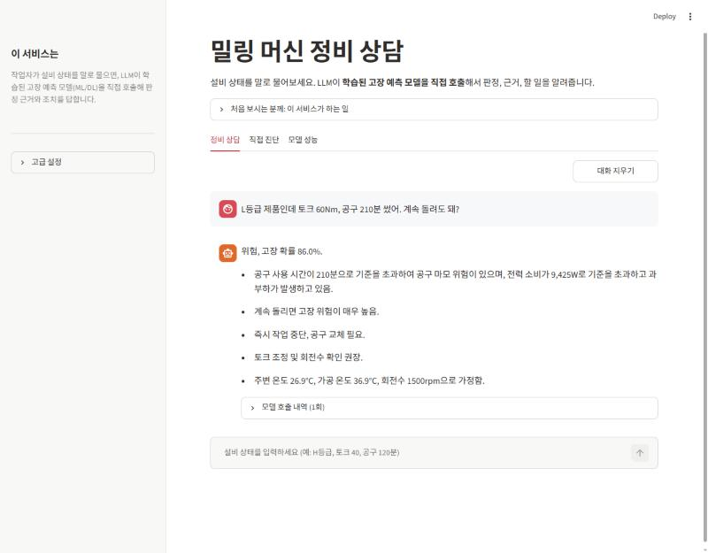
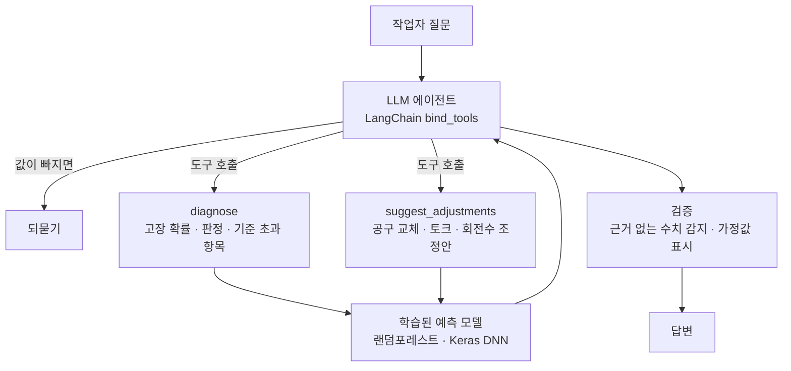
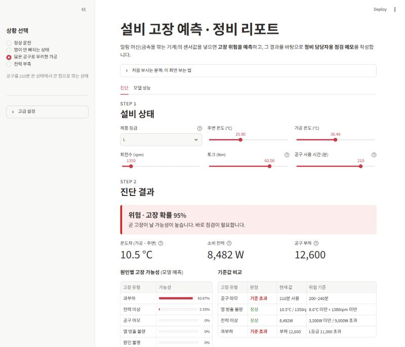
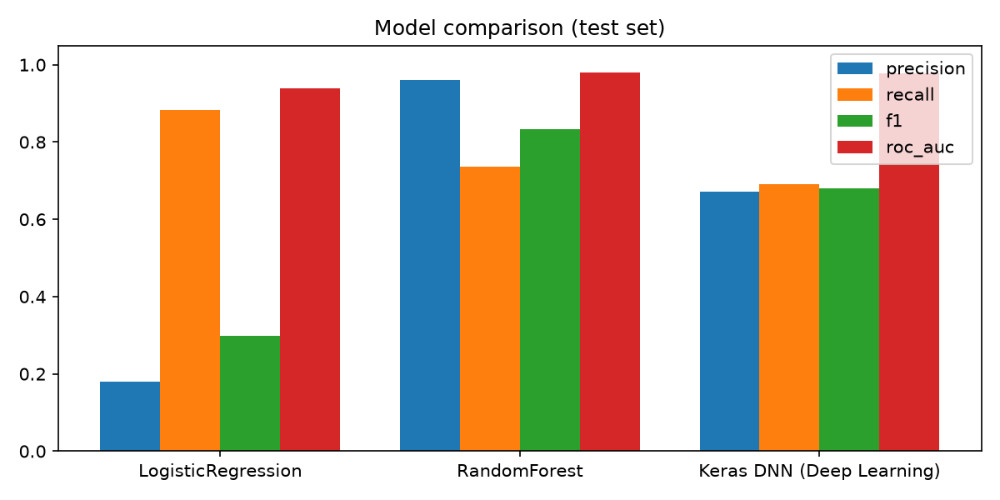
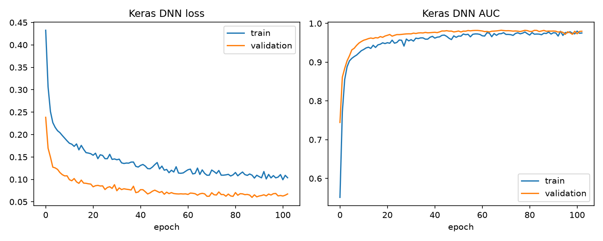
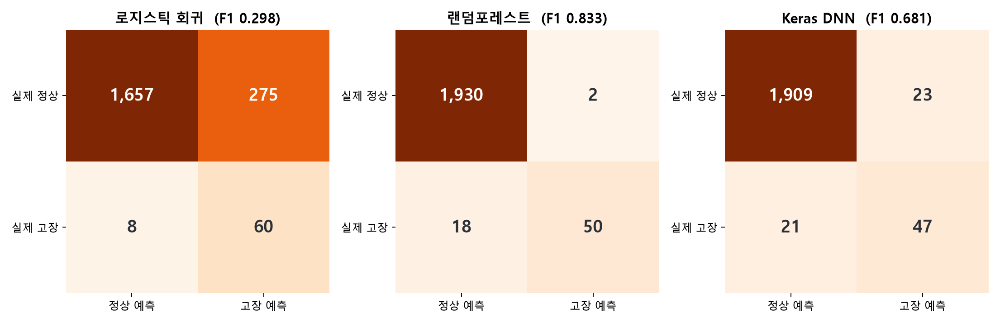
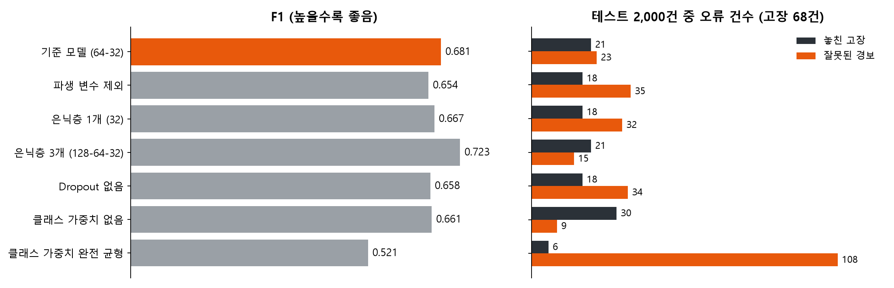

# 밀링 머신 정비 상담 에이전트

작업자가 설비 상태를 말로 물으면, LLM이 학습된 고장 예측 모델(ML/DL)을 직접 호출해서 판정 근거와 조치를 답하는 Streamlit 서비스입니다.

- 시연: `https://(배포 후 주소 입력).streamlit.app`
- 과제: 딥러닝 + LLM 서비스 모델 (개인)



## 왜 만들었나

예지보전(Predictive Maintenance) 모델은 보통 "고장 확률 95%" 같은 숫자를 내놓는 데서 끝납니다. 현장 작업자에게 필요한 건 **"계속 돌려도 되는지, 안 되면 무엇을 바꿔야 하는지"**에 대한 답입니다.

이 서비스에서는 **LLM이 상담 창구** 역할을 합니다.

- 작업자의 말에서 설비 값을 알아듣고, 빠진 값은 되묻습니다.
- 어떤 계산이 필요한지 판단해서 예측 모델을 도구로 호출합니다.
- 여러 계산 결과를 비교해서 판정, 근거, 할 일로 정리합니다.

숫자(고장 확률, 판정, 조정 효과)는 항상 학습된 모델이 계산하고, LLM은 그 숫자로만 설명합니다.

## 대화 예시

실제 실행 결과를 줄여서 정리했습니다.

```
작업자: L등급 제품인데 토크 60Nm, 공구 210분 썼어. 계속 돌려도 돼?
  └ diagnose(L, 토크 60, 공구 210분) 호출
상담:   위험, 고장 확률 86.0%
        - 공구 사용 210분 (위험 구간 200~240분)
        - 소비 전력 9,425W (9,000W 초과)
        - 공구 부하 12,600 (L등급 한계 11,000 초과)
        가정: 주변 26.9°C, 가공 36.9°C, 회전수 1500rpm
        (회전수를 말하지 않아 평균값으로 계산. 실제 값을 알려주면 다시 계산)

작업자: 그럼 어떻게 하면 돼? 공구 교체 말고 다른 방법도 있어?
  └ suggest_adjustments(...) 호출 → 공구 교체 / 토크 낮추기 / 회전수 조정을 모델로 계산
상담:   토크를 50Nm로 낮추면 주의(8.7%)
        공구만 교체하면 소비 전력 9,425W 초과가 남아 위험(56.0%)
        공구 마모 구간은 공구 교체로만 해소됨

작업자: 토크만 40으로 낮추면?
  └ 이전 값을 이어 받아 diagnose(L, 토크 40, 공구 210분) 호출
상담:   주의, 고장 확률 8.3%. 공구 부하는 기준 이내로 내려가지만 공구 마모 위험은 남음
```

## 동작 구조



| 역할 | 담당 |
|---|---|
| 질문 이해, 값 추출, 도구 선택, 결과 종합, 설명 | **LLM** (OpenAI gpt-4o-mini, Tool Calling) |
| 고장 확률, 고장 유형 예측 | **ML/DL** (랜덤포레스트, Keras 심층 신경망) |
| 판정(정상/주의/위험), 기준값 비교, 조정안 탐색 | 코드 (모델 결과 기반) |
| 답변 검증 | 코드 (도구 결과에 없는 수치 감지, 가정값 누락 시 자동 표시) |

## 화면 구성

| 탭 | 내용 |
|---|---|
| **정비 상담** | LLM 에이전트와 대화. 답변마다 "모델 호출 내역"을 펼쳐 어떤 값으로 모델을 불렀는지 확인 가능 |
| 직접 진단 | 슬라이더로 값을 바꿔 가며 모델 결과를 바로 확인하고, LLM 정비 메모 작성 |
| 모델 성능 | 모델 비교, 심층 신경망 학습 곡선, 고장 유형별 성능, 특성 중요도 |



## 기술 스택

| 구분 | 사용 기술 |
|---|---|
| LLM | LangChain (`bind_tools` 에이전트 루프, LCEL 체인), OpenAI `gpt-4o-mini`, Ollama `gemma2` (메모 작성, 로컬) |
| 딥러닝 | TensorFlow / Keras (Dense, Dropout, EarlyStopping, class_weight) |
| 머신러닝 | scikit-learn (로지스틱 회귀, 랜덤포레스트, ColumnTransformer, Pipeline) |
| 화면 | Streamlit |

## 데이터

[AI4I 2020 Predictive Maintenance Dataset](https://archive.ics.uci.edu/dataset/601/ai4i+2020+predictive+maintenance+dataset) (UCI, CC BY 4.0)

- 밀링 머신 10,000건, 고장 339건 (3.4%)
- 입력: 제품 등급(L/M/H), 주변 온도, 가공 온도, 회전수, 토크, 공구 사용 시간
- 고장 유형 5가지: 공구 마모, 열 방출 불량, 전력 이상, 과부하, 원인 불명

고장 원리에 맞춰 파생 변수 3개를 추가했습니다.

| 파생 변수 | 계산 | 관련 고장 |
|---|---|---|
| 온도차 | 가공 온도 − 주변 온도 | 열 방출 불량 |
| 소비 전력 | 토크 × 각속도 | 전력 이상 |
| 공구 부하 | 공구 사용 시간 × 토크 | 과부하 |

## 예측 모델 성능

테스트 데이터 2,000건 기준입니다. 고장이 3.4%뿐이라 모두 "정상"이라고 해도 정확도가 96.6%가 나오므로, F1과 재현율로 비교했습니다.

| 모델 | 정확도 | 정밀도 | 재현율 | F1 | ROC-AUC |
|---|---|---|---|---|---|
| 로지스틱 회귀 | 0.859 | 0.179 | 0.882 | 0.298 | 0.939 |
| **랜덤포레스트** | **0.990** | **0.962** | 0.735 | **0.833** | **0.979** |
| Keras DNN | 0.978 | 0.671 | 0.691 | 0.681 | 0.979 |

- 에이전트는 F1이 가장 높은 랜덤포레스트를 씁니다. 실제 고장 68건 중 50건을 잡았고, 잘못 울린 경보는 2건입니다.
- Keras DNN은 AUC는 같지만 F1이 낮았습니다. 표 형태의 작은 데이터에서는 트리 모델이 유리했습니다.
- 전력 이상(F1 1.00), 과부하(0.97), 열 방출 불량(0.83)은 잘 맞췄지만 공구 마모와 원인 불명은 맞추지 못했습니다(0.00). 두 유형은 무작위성이 커서 센서값만으로는 예측하기 어렵습니다.

<p>


</p>



### 딥러닝 실험

Keras DNN의 기준 설정(파생 변수 사용, 은닉층 64-32, Dropout 0.3, 제곱근 클래스 가중치)에서 한 가지만 바꿔 같은 데이터로 다시 학습했습니다. (`python dl_experiments.py`)

| 실험 | F1 | 재현율 | 정밀도 | 놓친 고장 | 잘못된 경보 |
|---|---|---|---|---|---|
| 기준 모델 (64-32) | 0.681 | 0.691 | 0.671 | 21 | 23 |
| 파생 변수 제외 | 0.654 | 0.735 | 0.588 | 18 | 35 |
| 은닉층 1개 (32) | 0.667 | 0.735 | 0.610 | 18 | 32 |
| 은닉층 3개 (128-64-32) | **0.723** | 0.691 | 0.758 | 21 | 15 |
| Dropout 없음 | 0.658 | 0.735 | 0.595 | 18 | 34 |
| 클래스 가중치 없음 | 0.661 | 0.559 | 0.809 | 30 | 9 |
| 클래스 가중치 완전 균형 | 0.521 | 0.912 | 0.365 | 6 | 108 |

- 파생 변수와 Dropout은 잘못된 경보를 줄였습니다 (빼면 23건 → 34~35건).
- 은닉층 3개가 가장 좋았지만 랜덤포레스트(F1 0.833)보다는 낮아, 에이전트의 예측 도구는 랜덤포레스트를 유지했습니다.
- 클래스 가중치는 없으면 고장을 많이 놓치고, 완전 균형이면 경보가 지나치게 많아집니다. 제곱근 가중치가 그 사이입니다.
- 실험마다 1회씩 학습한 결과라, 고장 68건 기준 몇 건 차이는 무작위 변동일 수 있습니다.



## LLM을 믿을 수 있게 만든 과정

개발하면서 LLM이 틀리는 경우를 여러 번 만났고, 그때마다 프롬프트에만 기대지 않고 코드로 막았습니다.

| 문제 | 해결 |
|---|---|
| 정상 설비(고장 확률 0%)를 LLM이 "위험"으로 판정 | 판정은 코드가 정하고 LLM은 설명만 하게 변경. 판정이 다르면 자동 교정 |
| 기준 이내 항목까지 원인으로 나열 | 기준 초과 항목과 이내 항목을 나눠서 전달 |
| 회전수를 가정해서 계산한 결과인데 가정 사실을 숨김 | 도구 결과에 가정값을 넣고, 답변에 없으면 코드가 마지막 줄에 자동 표시 |
| 확률 수치를 지어낼 위험 | 답변의 퍼센트 수치를 도구 결과와 대조해서, 없는 수치면 경고 표시 |
| 로컬 소형 모델(gemma4 2B)은 도구를 호출하지 못하고 도구 이름만 출력 | 상담 에이전트는 Tool Calling이 안정적인 OpenAI로 고정 |

## 폴더 구조

```
├── app.py                  Streamlit 앱 (정비 상담 / 직접 진단 / 모델 성능)
├── train.py                예측 모델 학습 · 평가 · 그래프 저장
├── make_figures.py         보고서용 그래프 (혼동 행렬, 파생 변수 분포)
├── dl_experiments.py       딥러닝 실험 실행 (파생 변수 · 구조 · Dropout · 클래스 가중치 비교)
├── main.ipynb              전체 과정 노트북 (Colab 실행 가능)
├── requirements.txt
├── data/ai4i2020.csv       학습 데이터
├── src/
│   ├── agent.py            MaintenanceAgent       LLM 에이전트 · 도구 · 답변 검증
│   ├── data_loader.py      AI4IDataLoader         데이터 로드 · 파생 변수 · 분할
│   ├── dl_model.py         KerasFailureClassifier Keras 심층 신경망
│   ├── dl_experiment.py    DLExperiment           딥러닝 설정별 비교 실험
│   ├── models.py           FailurePredictor       모델 3종 학습 · 평가 · 예측
│   ├── rule_checker.py     FailureRuleChecker     고장 유형별 기준값 비교
│   └── llm_reporter.py     MaintenanceReporter    LangChain 정비 메모 · 판정 검증
├── outputs/                성능 지표, 그래프
├── docs/                   README용 이미지
└── .streamlit/secrets.toml.example   API 키 설정 예시
```

## 실행 방법

```bash
pip install -r requirements.txt
python train.py          # 예측 모델 학습 (건너뛰면 앱 첫 실행 때 자동 학습, 1~2분)
python make_figures.py   # 보고서용 그래프 (선택)
python dl_experiments.py # 딥러닝 설정 비교 실험 (선택, 수 분)
streamlit run app.py
```

`.streamlit/secrets.toml.example`을 `secrets.toml`로 복사하고 OpenAI 키를 넣습니다. 앱의 "고급 설정"에 직접 입력해도 됩니다. 정비 상담 탭은 OpenAI 키가 있어야 동작합니다.

직접 진단 탭의 정비 메모는 로컬 Ollama(`ollama pull gemma2`)로도 만들 수 있습니다. Ollama가 켜져 있을 때만 선택지가 나타납니다.

## 배포 (Streamlit Community Cloud)

1. 이 저장소를 GitHub에 올립니다.
2. [share.streamlit.io](https://share.streamlit.io)에서 **Create app** → 저장소 선택 → Main file: `app.py`
3. **Advanced settings**에서 Python 3.12를 고르고, Secrets에 아래 내용을 넣습니다.
   ```toml
   OPENAI_API_KEY = "sk-..."
   ```
4. Deploy. TensorFlow 설치와 첫 모델 학습 때문에 처음 실행은 몇 분 걸립니다.

## 한계와 개선 방향

**한계**
- AI4I는 실제 공장 데이터를 본떠 만든 합성 데이터이고, 고장 라벨도 규칙으로 만들어졌습니다. 실제 공장에서는 성능이 더 낮을 수 있습니다.
- 한 시점의 센서값만 보고 판단합니다. 실제 고장은 시간에 따라 서서히 나빠지는 패턴으로 나타납니다.
- 공구 마모와 원인 불명 고장은 예측하지 못합니다.

**개선 방향**
- 설비 매뉴얼과 과거 정비 이력을 RAG로 연결해서, 조치 방법을 문서 근거와 함께 안내
- 실시간 센서 값을 받아 위험해지면 에이전트가 먼저 알림
- 진동·전류 같은 시계열 데이터로 LSTM 기반 잔여 수명(RUL) 예측

## 출처

- 데이터: Matzka, S. (2020). *Explainable Artificial Intelligence for Predictive Maintenance Applications.* AI4I 2020. UCI Machine Learning Repository, CC BY 4.0
